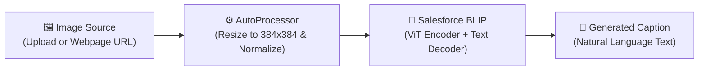

# 🖼️ Project 01: AI Image Captioner

An AI-powered image captioning application powered by **Salesforce BLIP** (~0.25B parameters). Upload any photo or input a webpage URL to automatically scrape, filter, download, and describe every image found.

[](https://colab.research.google.com/github/mitadrudeb/building-genai-powered-applications/blob/main/01-ai-image-captioner/AI_Image_Captioner.ipynb)


> 💡 **Google Colab Note:** If running from a private GitHub repository, ensure you grant Google Colab access to your private GitHub repos under *File > Open notebook > GitHub*, or set the repository to public when showcasing on your resume/portfolio.

---

## ✨ Features

| Feature | Description |
|---------|-------------|
| **📤 Single Image Upload** | Drag & drop any photo from your device to generate an instant natural language caption |
| **🌐 Webpage URL Scraping** | Input any webpage URL (e.g. Wikipedia) → auto-extract, filter, and caption all images |
| **🛡️ Defensive Scraping** | Automatically ignores SVGs, base64 data URIs, and tiny icons/tracking pixels (< 400px area) |
| **⚡ Lightweight & Fast** | Uses **Salesforce BLIP (~247M params)**; runs in seconds on consumer CPUs & accelerates on CUDA GPUs |
| **💻 Cross-Platform** | Zero external compilers; runs out-of-the-box on **Google Colab, Windows, Linux, and macOS** |
| **🆓 Zero Cost** | 100% open-source with no paid API keys required |

---

## 🤖 Model Details

| Model | Parameters | Architecture | Hub Link |
|-------|------------|--------------|----------|
| **Salesforce/blip-image-captioning-base** | ~247M (~0.25B) | ViT-B/16 Vision Encoder + BERT Text Decoder | [Hugging Face Model Card](https://huggingface.co/Salesforce/blip-image-captioning-base) |

---

## 📸 Architecture & Pipeline



### 1. Upload Mode
1. User uploads an image through the Gradio interface.
2. The image is converted into an RGB array and passed to the BLIP processor.
3. The model autoregressively generates descriptive text tokens and decodes them.

### 2. URL Scraping Mode
1. User provides a webpage URL (e.g., Wikipedia).
2. `BeautifulSoup` parses the HTML and extracts all `` tags (`src`, `data-src`, `srcset`).
3. Relative paths are converted to absolute URLs using `urllib.parse.urljoin`.
4. Invalid formats (SVGs, data URIs, icons `< 400px`) are filtered out.
5. Up to `max_images` are downloaded in-memory and captioned sequentially.

---

## 🚀 Quick Start

### Option 1: Run in Google Colab (1-Click Cloud Execution)

Click the badge or the link below to open and run the complete notebook in Google Colab:

[](https://colab.research.google.com/github/mitadrudeb/building-genai-powered-applications/blob/main/01-ai-image-captioner/AI_Image_Captioner.ipynb)

**Direct Google Colab Link:**  
🔗 [https://colab.research.google.com/github/mitadrudeb/building-genai-powered-applications/blob/main/01-ai-image-captioner/AI_Image_Captioner.ipynb](https://colab.research.google.com/github/mitadrudeb/building-genai-powered-applications/blob/main/01-ai-image-captioner/AI_Image_Captioner.ipynb)

### Option 2: Run Locally

```bash
# 1. Navigate to this project folder
cd 01-ai-image-captioner

# 2. Install dependencies
pip install -r requirements.txt

# 3. Launch the notebook
jupyter notebook AI_Image_Captioner.ipynb
```

The Gradio web interface will launch locally at `http://127.0.0.1:7860`.

---

## 📂 Project Structure

```
01-ai-image-captioner/
├── AI_Image_Captioner.ipynb   # Main Jupyter notebook (ready to run)
├── requirements.txt           # Project dependencies
└── README.md                  # Project documentation
```

---

## 💡 Key Engineering Takeaways

- **Vision-Language Alignment:** How Vision Transformers (ViT) patchify images into visual tokens that cross-attend with text token embeddings.
- **Edge-Ready Efficiency:** Using compact ~250M parameter models that execute in seconds on standard CPU hardware without multi-GPU overhead.
- **Defensive Ingestion:** Handling real-world web data quirks (relative URLs, vector graphics, tracking pixels, rate limits).
- **Interactive Prototyping:** Structuring modular Gradio blocks with tabbed workflows and public tunneling.
